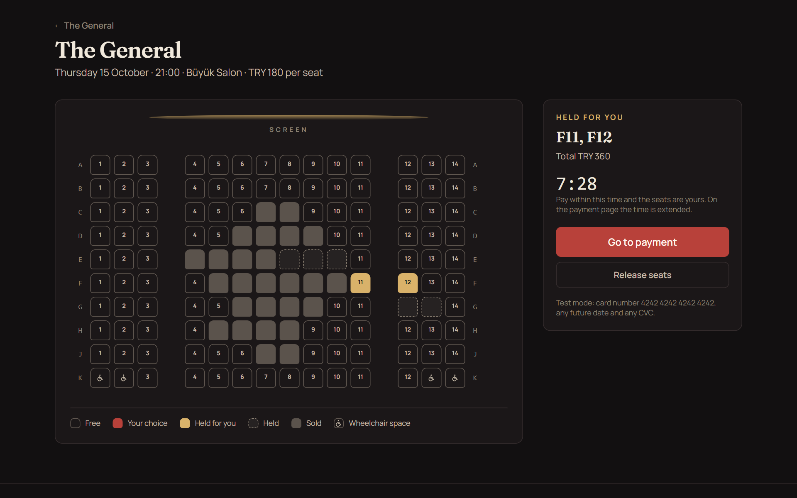
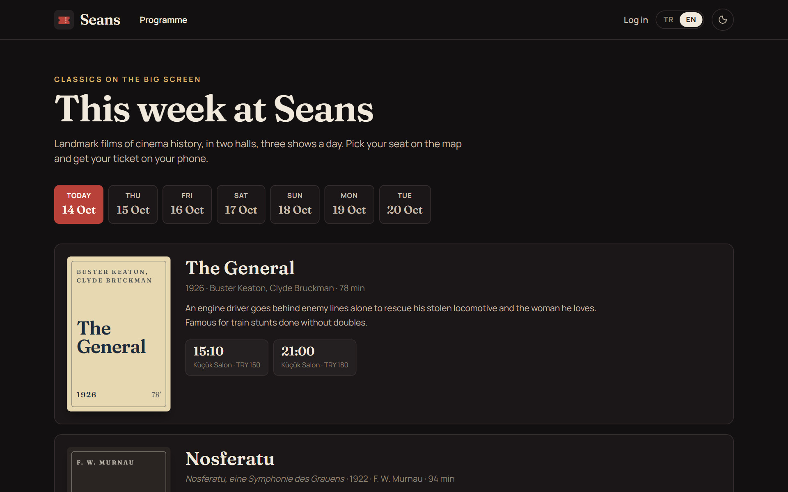
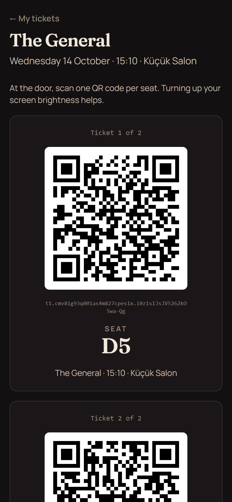
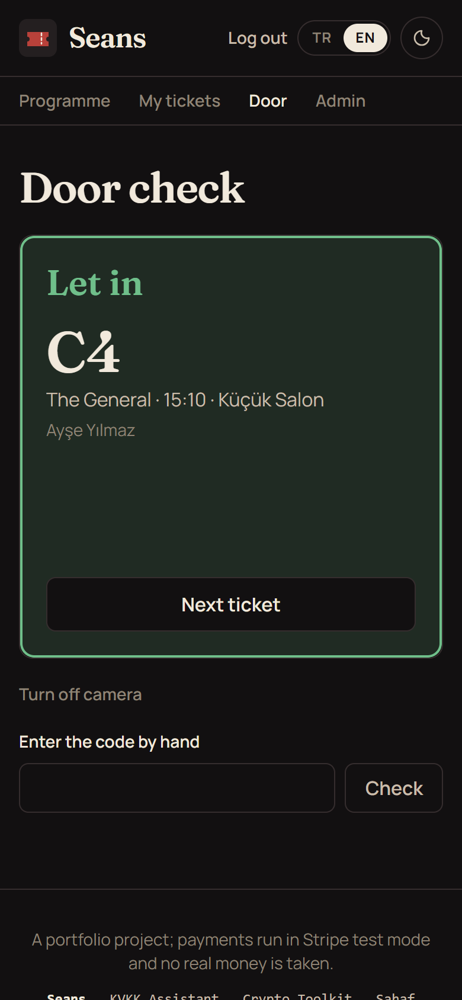
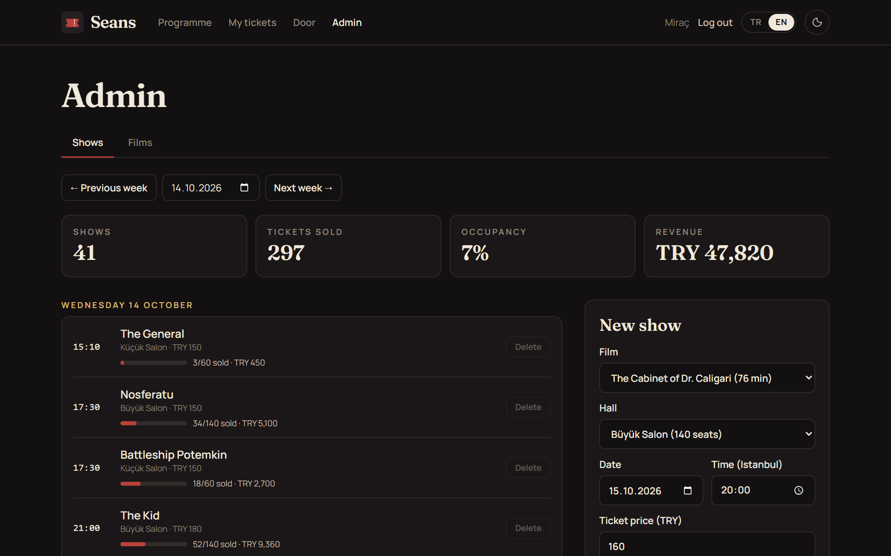
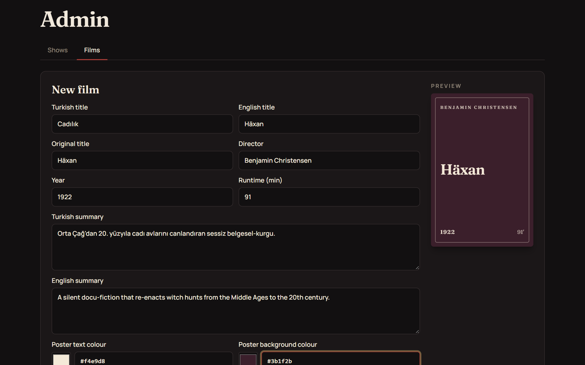

# Seans

**English** | [Türkçe](README.tr.md)

A cinema booking site for a small two-hall cinema that shows silent-era classics. Visitors pick seats on a live seat map, pay with Stripe (test mode), and get one QR ticket per seat by e-mail. Staff scan the tickets at the door with a phone camera, and the admin manages films, showtimes and sales.

**Live demo:** [seans.miracdeprem.com](https://seans.miracdeprem.com)



## Features

- **Programme:** two halls, three shows a day, for the next two weeks. A daily job adds the coming days by itself, so the programme never runs out.
- **Typographic posters:** every film gets its own poster built from two colours and its title, with no image files.
- **Live seat map:**
  - Drawn from the hall's data, with aisles and wheelchair spaces.
  - It refreshes every few seconds, so a seat someone else takes shows up on its own.
  - Every seat is a real button, usable with a keyboard and a screen reader.
- **Seat holds without double booking:**
  - Chosen seats are held for 10 minutes while you pay.
  - The database itself guarantees that a seat can belong to only one booking. Two people clicking the same seat at the same moment cannot both get it; this is covered by a test.
  - A hold that runs out is freed automatically.
- **Payment with Stripe Checkout (test mode, Turkish lira):**
  - The booking is confirmed only by Stripe's signed webhook, never by the browser.
  - A payment that arrives after the hold expired is refunded automatically.
- **QR tickets:**
  - One ticket per seat, in the account and in a confirmation e-mail with the QR codes attached.
  - Each code is signed with HMAC, so a forged or altered ticket is rejected.
- **Door check for staff:**
  - The phone camera reads the QR code, and the screen answers in big colours: let in, already used (and since when), invalid, unpaid, too early or show over.
  - A ticket can be used only once, even if two doors scan it at the same moment.
- **Admin panel:**
  - Films: add, edit and delete, with a live poster preview. Unreadable colour pairs are rejected.
  - Showtimes: add a show at any time; the server rejects overlaps in the same hall, with a 20-minute cleaning break.
  - Sales: tickets sold, occupancy and revenue per show and per week.
  - Shows and films with sold tickets cannot be deleted.
- **Accounts:** sign-up with e-mail confirmation, log in, log out and password reset.
- **Turkish and English**, a dark and a light theme matching [my portfolio](https://www.miracdeprem.com), and layouts that work on phones.

## Screenshots

| Programme | Ticket on a phone | Door check |
|---|---|---|
|  |  |  |

| Admin: shows and sales | Admin: adding a film |
|---|---|
|  |  |

## Tech Stack

- **Frontend:** React, React Router, TanStack Query, Tailwind CSS, Vite
- **Backend:** Node.js and Express, running as a Vercel serverless function
- **Database:** PostgreSQL on [Neon](https://neon.tech), with the Prisma ORM
- **Payments:** [Stripe](https://stripe.com) Checkout and webhooks (test mode)
- **E-mail:** [Resend](https://resend.com)
- **QR codes:** `qrcode` to draw them, `jsQR` to read them from the camera
- **Validation:** zod on every request
- **Tests:** `node --test` and supertest, 70 tests against a separate test database
- **Hosting:** Vercel, with a daily cron job and a strict Content Security Policy

## Installation

The quickest way to try it is the [live demo](https://seans.miracdeprem.com). The payment page is in Stripe test mode: use the card number `4242 4242 4242 4242`, any future date and any CVC.

To run it locally you need Node.js 22.18 or newer and a free [Neon](https://neon.tech) PostgreSQL database.

```bash
git clone https://github.com/MrcDprm/movie-reservation-system.git
cd movie-reservation-system
npm install
cp .env.example .env        # fill in DATABASE_URL and DIRECT_URL from Neon
npm run db:deploy           # create the tables
npm run db:seed             # halls, films and two weeks of showtimes
npm run dev
```

Then open `http://localhost:5173`.

- **E-mail:** without a Resend key, e-mails (with the confirmation link) are printed in the terminal.
- **Payments:** add a Stripe test key (`sk_test_...`) to `.env`. Then forward webhooks with the Stripe CLI: `stripe listen --forward-to localhost:3001/api/stripe/webhook`.
- **Staff and admin roles:** give a role to an existing account with `npm run set-role -- you@example.com ADMIN` (or `STAFF`). There is deliberately no web page for this.

### Tests

The tests use a separate database so they never touch real data. Create a second Neon branch, put its addresses in `.env.test`, then:

```bash
npm run db:deploy:test
npm test
```

The test helper refuses to run if `.env.test` points at the same database as `.env`.

### Project structure

```
api/index.js              The Express app as a Vercel function
server/app.js             Middleware, security headers, routes
server/auth/              Sign-up, e-mail confirmation, login, sessions, password reset
server/booking/           Programme, seat map, holds, Stripe checkout and webhook
server/tickets.js         Signed QR codes and the door check
server/admin/             Films, showtimes and sales for the admin
server/programme.js       Daily top-up of showtimes and clean-up of expired rows
server/cron.js            The daily job's endpoint
server/rateLimit.js       Rate limiting in PostgreSQL
prisma/                   Database schema, migrations and demo data
web/src/pages/            Programme, film, seats, account, tickets, door and admin pages
web/src/components/       Layout, poster, seat map, form parts
tests/                    Unit and API tests
```

### Security

- **Passwords:** hashed with scrypt. Weak and common passwords, and ones containing your name or e-mail, are refused.
- **Sessions:** kept in an HttpOnly, Secure, SameSite cookie. The token in the cookie is stored only as a hash.
- **Requests:** API requests from other sites are refused.
- **E-mail confirmation and password reset:** links are single-use and expire.
- **Account privacy:** sign-up and "forgot password" give the same answer whether or not an e-mail is registered, so nobody can find out which addresses have accounts.
- **Rate limiting:** login, sign-up and e-mail sending are limited per IP address and per e-mail; holds, checkout and door scans are limited per account.
- **Input:** every request body is checked with zod, and only the expected fields are saved.
- **Database:** queries go through Prisma, so they are always parameterised.
- **Stripe webhooks:** checked against Stripe's signature.
- **Errors:** messages are short codes; no stack traces reach the browser.
- **Content Security Policy:** no inline scripts, no outside scripts, and no framing.

## What I Learned

- **Letting the database settle races.** Two people can click the same seat in the same millisecond. Instead of checking "is it free?" and then saving, I put a unique constraint on (show, seat), so the database itself refuses the second booking. The same idea makes a ticket single-use at the door: "set the check-in time only where it is still empty" can succeed only once.
- **Trusting the webhook, not the browser.** The page Stripe returns to proves nothing; anyone can open it. A booking becomes paid only when a signed webhook arrives. While it is on its way, the ticket page waits and checks again every few seconds. I also had to handle the unhappy timing: a payment that lands after the hold expired is refunded automatically.
- **Signed QR codes.** The QR holds the ticket's ID and a short HMAC signature. The door can tell a real ticket from a made-up one without storing any extra secret per ticket.
- **Sessions done properly.** The session lives in an HttpOnly cookie that JavaScript cannot read, and the database stores only its hash, so a leaked database cannot be used to log in. Changing the password signs out every other device.
- **Time zones in a real schedule.** Shows are stored in UTC and always shown in Istanbul time, whatever the visitor's computer says. The admin form sends times with "+03:00", so a show added from abroad still lands at the right hour.
- **Checking for overlaps.** Adding a show, making a film longer and the daily top-up all use the same rule: a film plus a 20-minute break must not run into the next one in the same hall.
- **Testing against a real database.** The API tests run on a separate Neon branch. A helper refuses to run if it would touch the main database.
- **Reading a camera in the browser.** iPhones have no built-in barcode reader for web pages, so the door page draws camera frames on a canvas a few times a second and decodes them with jsQR. I tested it with a fake camera that shows a ticket.

## Future Plans

- Choosing different ticket types, such as student or child prices.
- Cancelling a paid booking from the account, with a refund.
- Wallet passes for Apple Wallet and Google Wallet.
- A page for staff to see how many guests are already inside.

## Credits

- All films are in the public domain. The summaries were written for this project, and the posters are generated, not copied.
- Fonts: [Fraunces](https://fonts.google.com/specimen/Fraunces) and [Manrope](https://fonts.google.com/specimen/Manrope) (SIL Open Font License), served from the site itself.

## License

[MIT](LICENSE)
